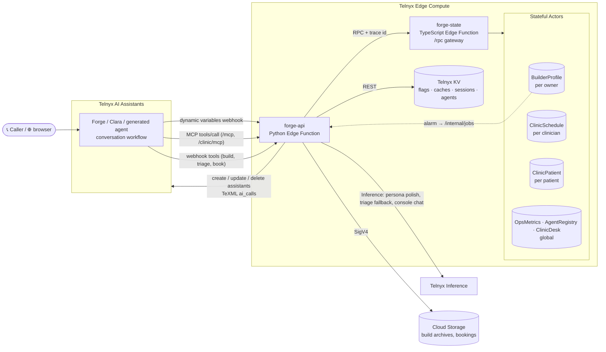
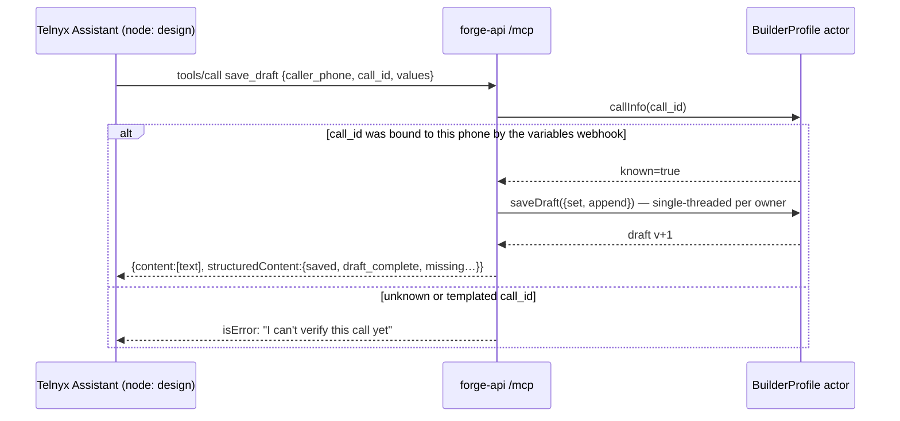
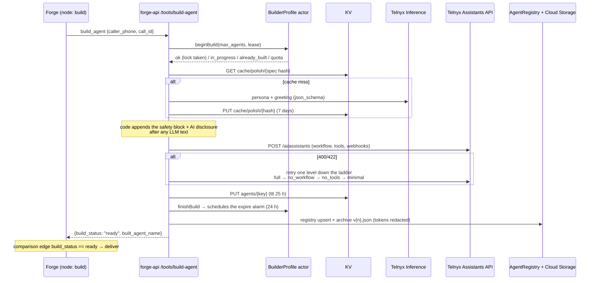
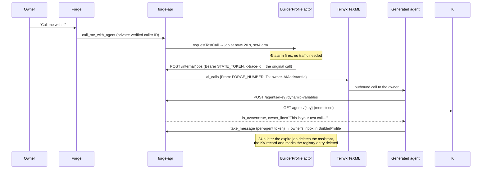
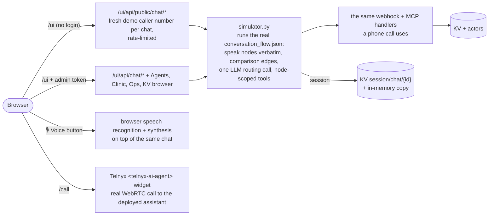
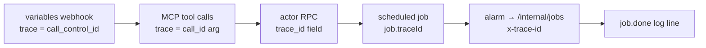

# How it works

Every diagram below is Mermaid, which GitHub renders directly. Workflow diagrams generated from the deployed JSON are in
[workflows.md](workflows.md) (regenerate with `python3 scripts/flow_to_mermaid.py --all > docs/workflows.md`).

## 1. The pieces



| Piece | What it does | Why this primitive |
|---|---|---|
| **forge-api** (Edge Function, Python) | Every webhook, both MCP servers, the build pipeline, the console and its simulator, `/internal/jobs` for alarms | Stateless request handling; scales to zero |
| **forge-state** (Edge Function, TypeScript) | Thin, token-protected `/rpc` gateway in front of the actors (actors are TS classes reached through bindings) | The only way Python can reach actors |
| **BuilderProfile** actor (one per owner phone) | Draft, build lock, quota, inbox, call binding, scheduled jobs + alarm | Read-modify-write that must be single-threaded: 4 concurrent builds → 1 assistant |
| **ClinicSchedule** actor (one per clinician) | Bookings | "Is the slot free? then take it" must be atomic |
| **ClinicPatient** actor (one per phone) | Appointments, upcoming limit, last triage | Check-then-act limit |
| **OpsMetrics / AgentRegistry / ClinicDesk** (global) | Counters and latency, agent index, callbacks + activity | Concurrent appends; OpsMetrics is shared by the API (RPC) and alarms (binding) |
| **KV** | `flags/global`, `flags/clinic` · `cache/polish/*`, `cache/triage/*` · `session/chat/*` · `agents/{key}` | Read-heavy, TTL'd, single-writer data: flags, caches, sessions, published config |
| **Cloud Storage** | `forge/builds/{key}/v{n}.json`, `clinic/appointments/{id}.json` | Documents that outlive the agent |

## 2. A call starts: the dynamic variables webhook

```mermaid
sequenceDiagram
  autonumber
  participant T as Telnyx Assistant
  participant A as forge-api
  participant K as KV
  participant S as BuilderProfile actor
  T->>A: POST /webhook/dynamic-variables?token=… {caller, call_control_id, verified}
  par read flags (memoised 30 s)
    A->>K: GET flags/global
  and bind the call
    A->>S: startCall(owner, call_id, attested)
  end
  S-->>A: callCount, hasDraft, activeAgents, unread…
  A-->>T: {"dynamic_variables": {welcome_line, quota_remaining, builds_enabled, has_draft, …}}
  Note over T: welcome speak node reads {{welcome_line}};<br/>router's comparison edges read builds_enabled / quota_remaining
```

If KV or the actor fails, the webhook still answers 200 with defaults and `degraded=true`. The call carries on, and
the outcome is counted in OpsMetrics.

## 3. An MCP tool call (and why the LLM can't act for someone else)



Tools are scoped per workflow node (`node_tools.json`): the router has none, discover has `list_templates` and
`save_draft`, build only has `build_agent`.

## 4. Building an agent



## 5. The test call and auto-expiry (actor alarms)



## 6. Clara books an appointment

```mermaid
sequenceDiagram
  participant P as Patient
  participant C as Clara
  participant A as forge-api
  participant Sch as ClinicSchedule (per clinician)
  participant Pat as ClinicPatient (per phone)
  P->>C: "My knee hurts when I run"
  C->>A: triage_symptoms (webhook)
  Note over A: rules decide urgency (crisis > emergency > urgent > routine);<br/>an LLM may only pick a specialty from a closed enum
  A-->>C: triage_urgency=routine, matched_specialty=orthopedics
  Note over C: comparison edge triage_urgency == routine → schedule<br/>(== emergency → 911 speak node)
  C->>A: check_availability (MCP) → generate slots − Sch.taken()
  C->>A: book_appointment {slot_id, full_name}
  A->>Sch: book(slot) — atomic: one winner per slot
  A->>Pat: addAppointment (limit) — on "limit", A cancels the slot again (compensation)
  A-->>C: booking_status=confirmed, booking_line
  Note over C: booking_status == confirmed → booked speak node
```

## 7. The browser: console chat, voice and calls



## 8. Following one call: the trace id



One `grep <call_control_id>` over `telnyx-edge logs forge-api` shows the call, every tool, the build, and the
test call that happened later. Every response also carries `server-timing` with per-hop spans (KV, actor,
inference, Assistants API).
