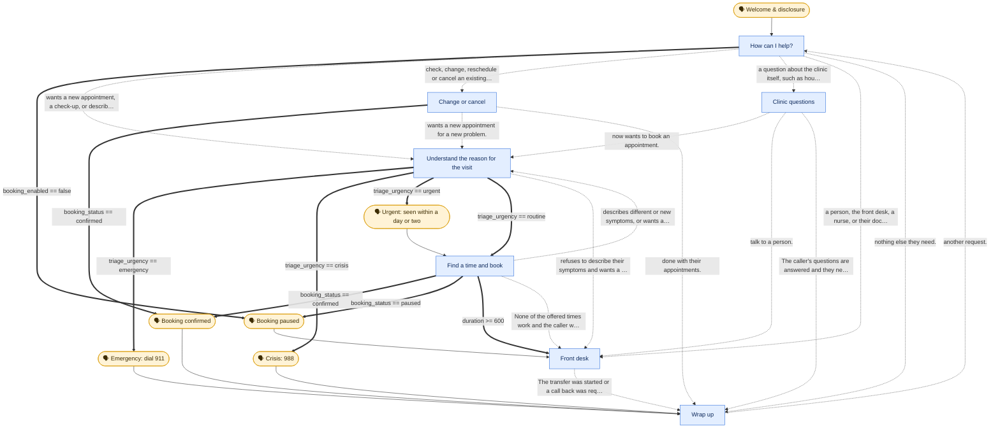
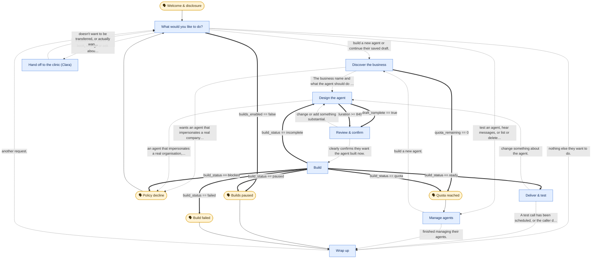

# Workflows (generated by scripts/flow_to_mermaid.py)

Thick arrows are **variable comparisons** (deterministic), dotted arrows are **LLM conditions**, plain arrows are the default edge out of a speak node. Amber stadiums are **speak** nodes (said verbatim), blue boxes are **prompt** nodes.

## clinic

## forge

